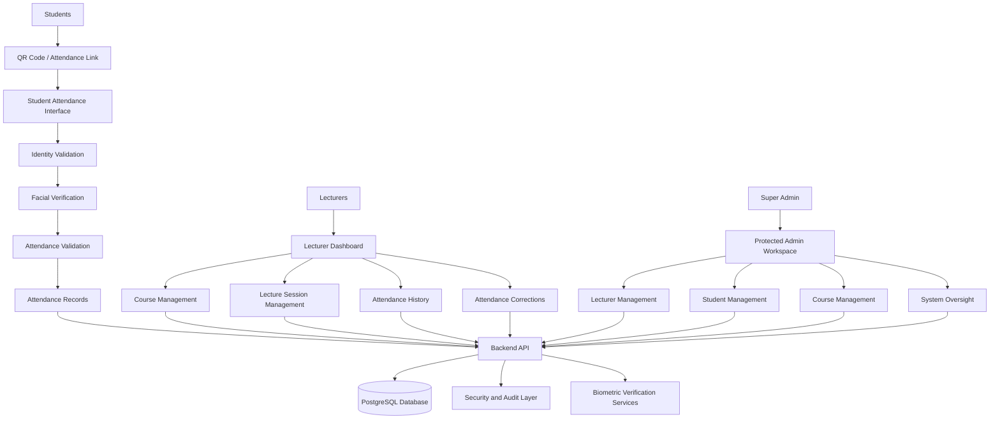

# MUST ICN Smart Attendance Management System

<p align="center">
  <strong>A Smart, Secure and Intelligent Attendance Management System for Information and Computer Networking Students at Mbeya University of Science and Technology (MUST).</strong>
</p>

<p align="center">
  
  
  
  
</p>

---

## 1. Project Overview

The **MUST ICN Smart Attendance Management System** is a web-based attendance management platform designed specifically for the Information and Computer Networking (ICN) programme at Mbeya University of Science and Technology (MUST).

The system aims to modernize the traditional lecture attendance process by introducing QR Code attendance, attendance links, facial verification, automated student validation, digital attendance records, lecturer dashboards, historical attendance tracking and centralized administrative management.

The system will allow lecturers to initiate lecture attendance sessions, while students will verify their identities using their full names, registration numbers and facial verification before attendance is recorded.

The platform is designed to support students using their own smartphones or a shared smartphone, allowing multiple students to independently verify and submit attendance during the same lecture session.

The system will also provide lecturers with a comprehensive attendance history, allowing them to retrieve and review records of lectures they have conducted from their first recorded session onwards.

---

## 2. Problem Statement

Traditional lecture attendance management often relies on manual attendance sheets, which can be time-consuming, inconvenient and difficult to manage.

Manual attendance methods may introduce challenges such as:

- Time-consuming attendance collection during lectures.
- Students signing attendance on behalf of others.
- Difficulty maintaining accurate attendance records.
- Loss or damage of physical attendance sheets.
- Difficulties retrieving previous lecture attendance records.
- Challenges in calculating attendance statistics.
- Limited ability to track attendance corrections.
- Poor accessibility to historical lecture information.
- Inefficient attendance management across multiple courses.

The MUST ICN Smart Attendance Management System addresses these challenges through digital attendance management, student identity validation, facial verification, centralized record management and comprehensive lecture history.

---

## 3. Project Objectives

### Main Objective

To develop a secure, intelligent and efficient web-based attendance management system for the Information and Computer Networking programme at MUST.

### Specific Objectives

- To digitize lecture attendance management.
- To implement QR Code-based attendance.
- To implement attendance through shareable links.
- To introduce facial verification for student attendance.
- To validate students using full names and registration numbers.
- To support multiple students using a shared smartphone.
- To provide lecturers with secure access to assigned courses.
- To maintain comprehensive lecture and attendance history.
- To provide attendance correction with accountability.
- To improve attendance reporting and analytics.
- To centralize ICN student, lecturer, course and attendance management.
- To protect student identity and biometric information.

---

## 4. Core Features

### 4.1 QR Code Attendance

Lecturers will be able to generate QR Codes for active lecture attendance sessions.

Students will scan the QR Code using their smartphones to access the attendance verification page.

The QR Code will direct students to the correct lecture session, where they will complete identity validation and facial verification.

Features include:

- Dynamic QR Code generation.
- Session-specific QR Codes.
- QR Code-based attendance access.
- Session expiration and validation.
- Secure session identification.
- Duplicate attendance prevention.
- QR Code session status validation.

### 4.2 Attendance Through a Link

The system will also provide attendance through a direct attendance link.

Students who cannot scan a QR Code will be able to access attendance using the lecturer's shared link.

The link will direct students to the appropriate active lecture session.

Features include:

- Direct attendance links.
- Session-specific URLs.
- Link-based attendance access.
- Session validation.
- Attendance link expiration.
- Duplicate attendance protection.

### 4.3 Facial Recognition and Verification

The system will incorporate facial verification to provide an additional layer of student identity verification.

The facial verification process will be integrated into student attendance submission.

The intended workflow includes:

1. Student facial enrollment.
2. Facial image capture.
3. Face detection.
4. Image quality validation.
5. Facial feature extraction.
6. Generation of facial embeddings.
7. Secure storage of biometric reference data.
8. Student attendance verification.
9. Comparison of the captured face against the enrolled facial reference.
10. Evaluation of verification scores against configured thresholds.
11. Liveness or anti-spoofing evaluation where supported.
12. Attendance submission after successful validation.

Facial verification will be designed as a 1:1 verification process, comparing the captured face against the reference associated with the validated student record.

The system will not rely solely on the student's registration number or facial similarity score without considering the configured verification requirements.

**Biometric security considerations:**

- Secure biometric reference storage.
- Restricted access to biometric data.
- Data minimization.
- Secure communication.
- Configurable verification thresholds.
- Protection against unauthorized biometric access.
- Liveness detection where technically supported.
- Defined biometric retention and deletion policies.
- Alternative verification procedures for verification failures.

Facial verification is intended to reduce attendance fraud, but it will not be treated as infallible identity proof.

### 4.4 Student Identity Validation

Students will be required to provide:

- Full Name.
- Registration Number.

Both fields will be required during attendance submission.

The system will validate the provided information against the registered student records before proceeding with facial verification.

Lecturers will be able to view students' full names and registration numbers in attendance records for identification, follow-up and academic attendance management.

Student identification will not depend solely on the device being used.

### 4.5 Shared Smartphone Attendance

The system will support multiple students using one smartphone to complete attendance during the same lecture session.

A smartphone will not be treated as the identity of a student.

Students will independently complete their attendance verification using the same device if necessary.

#### Shared Device Workflow

1. The lecturer starts a lecture attendance session.
2. The lecturer generates a QR Code or attendance link.
3. Student A accesses the attendance page.
4. Student A enters their full name and registration number.
5. The system validates Student A's information.
6. Student A completes facial verification.
7. The system records Student A's attendance.
8. The attendance page resets to a clean state.
9. Student B accesses the same attendance page using the same phone.
10. Student B enters their own information and completes facial verification.
11. Student B's attendance is independently recorded.
12. The process continues for other students.

#### Shared Device Security

The system will:

- Allow multiple students to submit attendance from one device.
- Independently validate each student's identity.
- Prevent duplicate attendance for the same student in the same session.
- Avoid using device ownership as a student identity.
- Clear previous student information after submission.
- Reset camera and verification state between students.
- Avoid exposing previously submitted students' sensitive information.
- Prevent one student's verification state from being reused by another student.

This approach allows students without individual smartphones to participate in digital attendance.

### 4.6 Student Management

The system will maintain student records for the ICN programme.

Student records will include relevant academic identification information.

Features will include:

- Student registration number.
- Student full name.
- Academic year or cohort where applicable.
- Student record management.
- Student course associations where required.
- Facial enrollment status.
- Student record validation.
- Student search and lookup.

Student enrollment into the system will support automatic and manual registration processes as defined by the project enrollment workflow.

Students will not have normal lecturer-style website accounts or password-based login access.

### 4.7 Lecturer Management

The system will support eight lecturer accounts.

Lecturer accounts will be created or approved by the Super Admin.

Lecturers will have access to their assigned courses and associated lecture sessions.

Features include:

- Lecturer account creation.
- Lecturer account approval.
- Lecturer authentication.
- Lecturer profile management.
- Course assignment.
- Assigned course access.
- Lecturer dashboard.
- Lecture session management.
- Attendance management.
- Attendance history.
- Attendance analytics.
- Attendance correction with reason.

Lecturers will only be authorized to access the courses, sessions and attendance records assigned to them.

### 4.8 Super Admin Management

The system will have one Super Admin.

The Super Admin is responsible for managing and administering the platform.

The Super Admin will have a separate protected administrative workspace.

Features include:

- Lecturer account management.
- Lecturer account approval.
- Course management.
- Student record management.
- Lecturer-course assignment management.
- System monitoring.
- Attendance management oversight.
- Administrative audit logs.
- System configuration.
- Data management oversight.

The system will not support additional peer Super Admin accounts.

Administrative access will be protected and restricted to the designated Super Admin.

### 4.9 Course Management

The system will support ICN academic courses and their associated lecturers.

Features include:

- Course creation.
- Course code management.
- Course title management.
- Course assignment to lecturers.
- Course-specific attendance sessions.
- Course attendance history.
- Course attendance analytics.

Lecturers will only access courses assigned to them.

### 4.10 Lecture Session Management

Lecturers will be able to create and manage lecture attendance sessions for their assigned courses.

Each lecture session will have its own unique identifier.

Features include:

- Lecture session creation.
- Course association.
- Lecturer association.
- Session start time.
- Session end time.
- Session status.
- QR Code generation.
- Attendance link generation.
- Attendance session activation.
- Attendance session closure.
- Attendance record management.
- Session attendance summary.

Each lecture session will maintain its own independent attendance records.

### 4.11 Comprehensive Lecture History

The system will preserve comprehensive lecture and attendance history for every lecturer, beginning with their first recorded lecture session and continuing throughout their authorized access to the system.

Lecturers will be able to log in at any time and retrieve historical records of lectures they have conducted.

The history feature will not be limited to recent lectures.

It will be designed to support retrieval of historical records across the lecturer's recorded sessions, subject to authorized access, retention policies and record availability.

#### Lecturer History Dashboard

The lecturer dashboard will provide:

- Total lectures conducted.
- Total attendance records.
- Total assigned courses.
- Recent lecture sessions.
- Attendance trends.
- Attendance statistics.
- Historical lecture records.

#### Lecture History Search and Filtering

Lecturers will be able to search and filter their lecture history using:

- Course name.
- Course code.
- Lecture date.
- Date range.
- Month.
- Semester.
- Academic year.
- Lecture session.

#### Individual Lecture Session Details

Each lecture session will provide detailed information, including:

- Lecture session ID.
- Course name.
- Course code.
- Lecturer name.
- Session date.
- Session start time.
- Session end time.
- Session status.
- Number of registered students where available.
- Number of students present.
- Number of students absent where applicable.
- Attendance verification methods.
- Attendance summary.

#### Student Attendance History

Each lecture session will maintain individual attendance records containing relevant information such as:

- Student full name.
- Student registration number.
- Attendance status.
- Attendance timestamp.
- Verification method.
- Verification outcome.
- Attendance correction status where applicable.

#### Historical Record Preservation

The system will be designed to:

- Preserve session-level attendance records.
- Maintain records independently for each lecture session.
- Prevent silent overwriting of historical attendance.
- Preserve attendance correction history.
- Support historical attendance retrieval.
- Support backup and archival policies.
- Maintain audit records for relevant actions.
- Apply documented data retention policies.

Historical records will not be silently erased through normal attendance operations.

Authorized archival, retention or deletion procedures will be governed by the system's data management policies.

### 4.12 Attendance Correction Management

Lecturers will be permitted to correct attendance records when necessary.

However, every attendance correction must include a reason.

The system will maintain correction history for accountability.

Correction records will include:

- Student identity.
- Lecture session.
- Original attendance value.
- Corrected attendance value.
- Correction reason.
- Lecturer or authorized actor.
- Correction timestamp.

Attendance corrections will not silently overwrite the original history.

The system will preserve a traceable audit history of attendance changes.

### 4.13 Attendance Analytics and Reporting

The system will provide attendance statistics and reports for lecturers and administrative purposes.

Features will include:

- Session attendance statistics.
- Course attendance summaries.
- Student attendance summaries.
- Attendance percentages.
- Attendance trends.
- Historical attendance reports.
- Course-level reports.
- Lecturer session reports.
- Attendance data filtering.
- Exportable reports where supported.

---

## 5. System Users and Roles

| User Role | Responsibilities |
|---|---|
| Super Admin | System administration, lecturer approval, course management, student management, configuration and oversight |
| Lecturer | Course management within assigned courses, lecture sessions, attendance management, history and correction |
| Student | Attendance submission through QR Code or attendance link, identity validation and facial verification |

Students will not have normal website accounts.

Student attendance access will be through the attendance session interface.

---

## 6. Attendance Workflow

### Step 1: Lecturer Authentication

The lecturer logs into the system using their authorized lecturer account.

### Step 2: Course Selection

The lecturer selects one of their assigned ICN courses.

### Step 3: Lecture Session Creation

The lecturer creates a lecture attendance session.

The system records the session information and generates a unique session identifier.

### Step 4: Attendance Access Generation

The system generates a QR Code and/or attendance link for the active lecture session.

### Step 5: Student Access

Students scan the QR Code or access the attendance link.

### Step 6: Student Information Submission

The student enters their full name and registration number.

### Step 7: Student Validation

The system validates the student information against registered student records.

### Step 8: Facial Verification

The student captures their face using the device camera.

The system performs the configured facial verification checks.

### Step 9: Attendance Validation

The system evaluates:

- Student record validity.
- Lecture session validity.
- Session availability.
- Facial verification result.
- Attendance duplication.
- Applicable attendance rules.

### Step 10: Attendance Recording

If the required verification conditions are satisfied, the system records the student's attendance against the specific lecture session.

### Step 11: Shared Device Reset

The system clears the previous student's identity and verification state, allowing another student to use the same device.

### Step 12: Lecturer Attendance Monitoring

The lecturer monitors attendance records and session statistics.

### Step 13: Session Closure

The lecturer closes the attendance session according to the session rules.

### Step 14: Historical Record Preservation

The lecture session and attendance records are preserved in the system's history for authorized future retrieval.

---

## 7. System Architecture

The system is planned around a modern web architecture with frontend, backend, database, authentication and facial verification services.



---

## 8. Technology Stack

The following technologies are proposed for the project.

| Component | Technology |
|---|---|
| Frontend | React |
| Frontend Build Tool | Vite |
| Styling | Tailwind CSS |
| Backend | Python |
| Backend Framework | FastAPI |
| Database | PostgreSQL |
| API Architecture | REST API |
| API Documentation | OpenAPI / Swagger |
| Authentication | Secure authentication and authorization |
| QR Code | QR Code generation and scanning |
| Facial Verification | Computer vision and biometric verification technologies |
| Version Control | Git |
| Repository Hosting | GitHub |
| Testing | Unit, integration and system testing |

---

## 9. Database Architecture

The database will be designed to support student records, lecturers, courses, lecture sessions, attendance, facial verification, corrections and audit history.

Proposed database entities include:

| Entity | Purpose |
|---|---|
| students | Student academic identification records |
| lecturers | Lecturer accounts and profiles |
| courses | ICN course information |
| lecturer_course_assignments | Lecturer-course relationships |
| lecture_sessions | Individual lecture attendance sessions |
| attendance_records | Individual student attendance records |
| attendance_verifications | Verification events and outcomes |
| student_biometric_profiles | Protected biometric reference data and enrollment metadata |
| attendance_corrections | Traceable attendance correction records |
| audit_logs | System action audit history |
| admins | Protected administrative account management |

The final database schema will be established during database architecture and design.

Biometric data will be handled separately from ordinary attendance records where appropriate, with restricted access and security controls.

---

## 10. Security, Privacy and Data Integrity

Security and privacy are important design requirements.

The system will be designed with the following principles:

- Secure authentication.
- Role-based authorization.
- Restricted administrative access.
- Lecturer-course access control.
- Student identity validation.
- Secure biometric data handling.
- Secure communication.
- Duplicate attendance prevention.
- Session validation.
- Attendance integrity.
- Auditable attendance corrections.
- Audit logging.
- Protection against unauthorized access.
- Data minimization.
- Defined data retention policies.
- Backup and recovery procedures.
- Shared-device privacy protection.
- Secure handling of verification failures.

The system will avoid exposing biometric references and sensitive student information unnecessarily.

Facial verification failures will not automatically result in permanent exclusion from attendance. A controlled alternative verification process will be defined.

---

## 11. Project Scope

The system will initially focus exclusively on the Information and Computer Networking (ICN) programme at Mbeya University of Science and Technology.

### Included in the Scope

- ICN student management.
- Lecturer account management.
- Course management.
- Lecturer-course assignment.
- Lecture session management.
- QR Code attendance.
- Attendance link access.
- Facial verification.
- Student identity validation.
- Shared smartphone attendance.
- Lecturer dashboard.
- Comprehensive lecture history.
- Attendance correction management.
- Attendance analytics.
- Administrative workspace.
- Audit logging.
- Data security and privacy controls.

### Excluded from the Initial Scope

- Other MUST academic programmes.
- Student normal website accounts.
- Student password-based login.
- Unrestricted lecturer access to other lecturers' records.
- Multiple Super Admin accounts.
- Uncontrolled attendance record modification.

---

## 12. Development Roadmap

The project will be developed progressively.

- [ ] Phase 1: Project repository and documentation.
- [ ] Phase 2: Requirements analysis and system design.
- [ ] Phase 3: Database architecture and ERD.
- [ ] Phase 4: Backend architecture and API development.
- [ ] Phase 5: Authentication and authorization.
- [ ] Phase 6: Student and lecturer management.
- [ ] Phase 7: Course management and lecturer assignments.
- [ ] Phase 8: Lecture session management.
- [ ] Phase 9: QR Code and attendance link implementation.
- [ ] Phase 10: Facial enrollment and verification.
- [ ] Phase 11: Shared smartphone attendance workflow.
- [ ] Phase 12: Attendance record management.
- [ ] Phase 13: Comprehensive lecturer history.
- [ ] Phase 14: Attendance correction and audit trail.
- [ ] Phase 15: Attendance analytics and reporting.
- [ ] Phase 16: Security testing and privacy review.
- [ ] Phase 17: System testing.
- [ ] Phase 18: Deployment and documentation.

---

## 13. Proposed Project Structure

```text
MUST-ICN-Smart-Attendancy-system/
│
├── frontend/
│   ├── src/
│   ├── public/
│   ├── components/
│   └── ...
│
├── backend/
│   ├── app/
│   │   ├── api/
│   │   ├── core/
│   │   ├── models/
│   │   ├── schemas/
│   │   ├── services/
│   │   ├── db/
│   │   └── main.py
│   └── ...
│
├── docs/
│   ├── requirements/
│   ├── architecture/
│   ├── database/
│   ├── api/
│   └── security/
│
├── tests/
│
├── .gitignore
├── README.md
└── LICENSE
```

The actual project structure may evolve during implementation.

---

## 14. Development Environment

The project will be developed using a modern development environment.

Recommended tools:

- Visual Studio Code.
- Git.
- GitHub.
- Python.
- Node.js.
- PostgreSQL.
- Web browser.
- Python virtual environment.
- Postman or equivalent API testing tool.

Installation and configuration instructions will be added as development progresses.

---

## 15. Documentation

Project documentation will be maintained within the repository.

Documentation may include:

- System requirements.
- Functional requirements.
- Non-functional requirements.
- Database architecture.
- Entity Relationship Diagram (ERD).
- API documentation.
- Authentication architecture.
- Facial verification architecture.
- Attendance workflows.
- Security architecture.
- Testing documentation.
- Deployment documentation.
- User guides.

---

## 16. Project Status

<details>
<summary>Current development status</summary>

The project is in its initial planning, requirements definition and repository foundation stage.

The system requirements, intended attendance workflows, user roles, attendance history requirements, facial verification requirements and security considerations are being defined before implementation.

The technologies and architecture outlined in this README represent the planned system design and are subject to refinement during development.

</details>

---

## 17. Contribution and Development Practices

Development will follow structured project management and version control practices.

- Maintain clear Git commit messages.
- Use organized project folders.
- Document architectural decisions.
- Separate frontend and backend responsibilities.
- Maintain database documentation.
- Test important features before integration.
- Protect sensitive data.
- Review changes before merging.
- Maintain a consistent development roadmap.

---

## 18. License

The project license will be defined once the project's ownership, distribution and licensing requirements have been finalized.

---

## 19. Author

**Maduhu Kondera Sokoni**

Project Developer

Information and Computer Networking (ICN)

Mbeya University of Science and Technology (MUST)

---

<p align="center">
  <strong>MUST ICN Smart Attendance Management System</strong><br>
  Smart Attendance. Secure Verification. Reliable Records.
</p>
